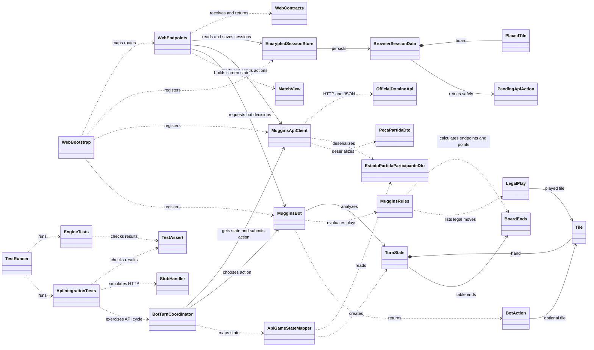

# Muggins

Jogo de Dominó Ponta de Quina com interface web local, integração com a API oficial e jogador autônomo implementado em C#.

## Demonstração

[Assistir à demonstração do jogo](https://youtu.be/XCLj6HgXgBA)

## Integrantes

| Nome | RM |
| --- | ---: |
| Gabriel Dias | 556830 |
| Gabriel Galerani | 557421 |
| Gustavo Alves | 557876 |
| Leonardo Taschin | 554583 |

## Visão geral

O projeto é dividido em três partes. `Muggins.Web` serve as páginas e coordena as ações dos jogadores. `Muggins.Engine` contém o modelo do jogo, as regras locais, a estratégia do bot e o cliente HTTP. `Muggins.Engine.Tests` executa verificações automatizadas do motor e do adaptador da API.

A API oficial é a autoridade para distribuir as pedras, validar jogadas, controlar turnos, calcular o placar e determinar o fim da partida. A interface apresenta o estado confirmado pela API. O código local do bot escolhe uma ação quando chega o turno de Muggins, e a API confirma ou rejeita essa ação.

## Diagrama de classes

O diagrama apresenta as classes principais e suas dependências. `WebBootstrap` representa a configuração de serviços e rotas feita em `Muggins.Web/Program.cs` com instruções top-level. O arquivo-fonte Mermaid também está disponível em [`docs/diagrama-de-classes.mmd`](docs/diagrama-de-classes.mmd) para revisão e exportação.



## Estrutura do repositório

- `Muggins.Web/`: servidor ASP.NET Core, endpoints locais e interface HTML/CSS/JavaScript.
- `Muggins.Engine/Api/`: DTOs, cliente HTTP, tratamento de erros e mapeamento dos estados da API.
- `Muggins.Engine/Domain/`: pedras, pontas, fases do turno e ações do bot.
- `Muggins.Engine/Rules/`: regras locais para avaliar encaixes e pontuação estimada.
- `Muggins.Engine/Bot/`: estratégia determinística do jogador autônomo.
- `Muggins.Engine.Tests/`: runner e cenários automatizados do motor e do adaptador HTTP.
- `run-muggins.ps1` e `run-muggins.sh`: atalhos para iniciar o servidor no Windows e em sistemas Unix.

## Requisitos e configuração

- .NET 8 SDK.
- Acesso à internet para chamar a API oficial.
- Conta FIAP/API habilitada, com acesso ao e-mail cadastrado para receber o token.
- Navegador atualizado.

O cliente usa por padrão [`https://domino-quina-api-b1-pf2261.azurewebsites.net/`](https://domino-quina-api-b1-pf2261.azurewebsites.net/), o endereço atual confirmado para esta entrega. A URL está definida em `MugginsApiClient.DefaultBaseAddress`, em `Muggins.Engine/Api/MugginsApiClient.cs`. O Swagger está disponível [neste endereço](https://domino-quina-api-b1-pf2261.azurewebsites.net/swagger/v1/swagger.json). Se o professor substituir o host, atualize o valor e este README juntos antes da demonstração.

## Instalação, build e execução

Na raiz do repositório, restaure e compile a aplicação web. O projeto Engine é restaurado e compilado como dependência:

```sh
dotnet restore Muggins.Web/Muggins.Web.csproj
dotnet build Muggins.Web/Muggins.Web.csproj
```

Inicie a aplicação web:

```sh
dotnet run --project Muggins.Web/Muggins.Web.csproj --launch-profile Muggins.Web
```

Abra <http://127.0.0.1:5080>. No Windows também é possível executar `./run-muggins.ps1`; em Linux ou macOS, use `./run-muggins.sh`.

O endereço `127.0.0.1` só abre no computador que está executando o servidor. Em um container remoto, encaminhe a porta `5080` e abra o endereço encaminhado no navegador.

## Primeiro acesso: conta e perfis de jogador

1. Abra a tela de conexão e informe o e-mail FIAP/API habilitado. O sistema solicita um token à API, que é enviado para esse e-mail. O projeto não cria nem provisiona a conta FIAP.
2. Cole o token recebido para conectar a sessão.
3. Prepare o perfil **Você**. Se a conta ainda não tiver um perfil de jogador, a aplicação permite criá-lo; depois, ativa o perfil na API para esta sessão.
4. Para jogar contra o computador, prepare também o perfil **Muggins**, que é um segundo jogador registrado na API. O bot local toma as decisões desse perfil.

O token de conta e as chaves de ativação dos jogadores são credenciais diferentes. A aplicação mantém esses dados no servidor local, protegidos com ASP.NET Core Data Protection, dentro de `.muggins-data/`. Essa pasta está ignorada pelo Git; mantenha-a no computador enquanto os perfis estiverem ativos. Não compartilhe nem publique tokens ou chaves.

## Como iniciar uma partida

### Contra o Muggins

Prepare os perfis **Você** e **Muggins**, escolha a pontuação-alvo — **25, 50 ou 100 pontos** — e inicie a partida. A interface local aciona o bot no turno do Muggins. O bot prioriza pontos imediatos, considera possíveis jogadas seguintes e usa critérios determinísticos para desempatar.

### Online com outra pessoa

1. O anfitrião conecta a própria conta, prepara seu perfil e cria uma sala.
2. Compartilha o código completo da sala com o outro jogador. Compartilhe o código, nunca o token da conta.
3. O outro jogador executa sua própria cópia do cliente, conecta a própria conta e entra com seu perfil usando o código.
4. Quando os dois perfis estiverem na sala, o anfitrião inicia a partida.

Cada jogador usa a própria conta FIAP/API e executa o cliente no próprio computador. A lista de salas mostra partidas aguardando um segundo participante.

## Regras de integração e estado da partida

- A API valida as ações e é a fonte oficial do estado, da pontuação e do vencedor.
- As ações incluem a versão do estado e uma chave de idempotência para evitar duplicação em tentativas repetidas.
- O campo `tabuleiro` da API vem orientado da esquerda para a direita: o `valorA` da primeira peça é a ponta esquerda e o `valorB` da última é a ponta direita. O cliente valida essa sequência ao reconstruir a mesa.
- O placar exibido vem das respostas confirmadas pela API. A pontuação estimada pelo bot serve apenas para escolher uma jogada.
- **Cancelar partida** encerra uma partida aberta sem vencedor e preserva o placar e o histórico. **Reiniciar** cria outra partida via API com os mesmos participantes, novo identificador e placar zerado.

Consulte [Muggins.Engine/README.md](Muggins.Engine/README.md) para detalhes das regras, da estratégia e dos tipos do motor.

## Testes automatizados

Execute o runner na raiz do repositório:

```sh
dotnet run --project Muggins.Engine.Tests/Muggins.Engine.Tests.csproj
```

O runner executa **14 cenários** e termina com código diferente de zero quando algum falha. A cobertura inclui cálculo de pontos com duplas abertas, jogadas legais, escolha de abertura e fases do bot, escolha de uma jogada pontuadora, desserialização e orientação do tabuleiro, autenticação e ativação de perfil, cabeçalhos e chave de idempotência, cancelamento e reinício, consulta do novo identificador, resposta `204`, conflito `409` e preservação de erros `401` da API. Os testes HTTP usam um handler simulado: não precisam de credenciais e não acessam a API real. O projeto usa esse runner próprio, por isso o comando é `dotnet run`, não `dotnet test`.

A interface web completa e uma partida online real ainda precisam de validação manual com acesso à API. Use o [checklist de validação da entrega](docs/validacao-da-entrega.md) e registre o commit e a saída dos testes.

O GitHub Actions compila a solução e executa o runner em cada atualização de `main` e em pull requests. A checagem de whitespace aplica as regras do `.editorconfig`.

## Convenções de código

O projeto usa .NET 8, C# 12, nullable reference types e namespaces alinhados às pastas (`Api`, `Bot`, `Domain` e `Rules`). Tipos e membros públicos usam `PascalCase`; parâmetros e variáveis locais usam `camelCase`. As configurações básicas de indentação e final de linha estão em `.editorconfig`.
